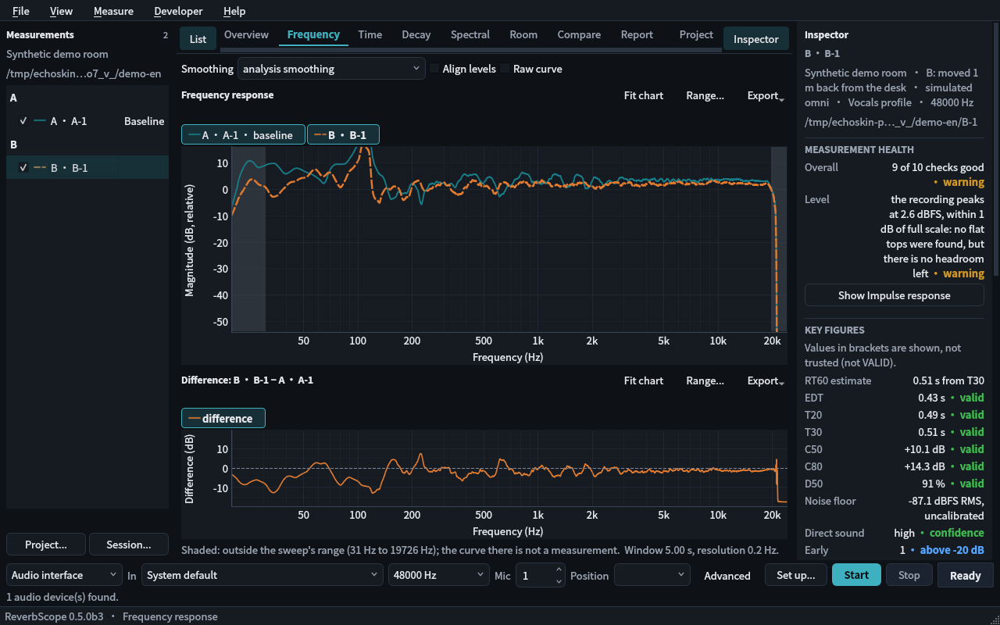

# EchoSkin

**Community skins for ReverbScope.** Reversible visual themes for the room-acoustics workstation — change the look, keep every measurement.

**English** | [简体中文](README.zh-CN.md)

[](LICENSE)



## What it is

EchoSkin is a community theme library for [ReverbScope](https://github.com/jingyemingyue/ReverbScope). Each skin is a folder with a `skin.json` manifest, a Qt stylesheet (`theme.qss`), and a preview image. Skins only change the appearance — measurement, analysis, and audio I/O are untouched.

**Principles:**
- **Reversible** — one click restores the stock look; no residue left behind
- **Non-invasive** — skins never touch measurement code or audio paths
- **Versioned** — each skin declares which ReverbScope versions it supports

## Gallery

| Skin | Author | Preview |
| --- | --- | --- |
| [Midnight Studio](themes/midnight-studio/) | EchoSkin team |  |

*Want your skin listed? See [Contributing](#contributing).*

## Install

1. Download a skin folder (or `.zip`) from `themes/`.
2. In ReverbScope, open **Settings → Appearance → Import Skin…** and pick the folder.
3. The skin applies immediately. To go back, choose **Restore Default**.

> Skin support requires ReverbScope 0.5.0b4 or newer. The appearance settings page is under development — check the [ReverbScope releases](https://github.com/jingyemingyue/ReverbScope/releases) for skin-loader availability.

## Make a skin

A skin is a folder with three files:

```
my-skin/
├── skin.json     # manifest: name, author, version, supported ReverbScope versions
├── theme.qss     # Qt stylesheet
└── preview.png   # 1280×800 preview screenshot (required)
```

Read the full format in [docs/SKIN_SPEC.md](docs/SKIN_SPEC.md), then follow the [skin-making guide](docs/MAKING_SKINS.md).

## Contributing

- **Submit a skin** — open a PR adding your folder under `themes/`. Include a real screenshot as `preview.png` (no mockups).
- **Report a bug** — use the issue templates; tell us your ReverbScope version and skin name.

## Safety

- Skins are plain stylesheets and images. They cannot run code.
- EchoSkin never modifies your ReverbScope installation; removing a skin folder fully reverts it.
- Only install skins from sources you trust.

## License

MIT — see [LICENSE](LICENSE). ReverbScope itself is a separate project under Apache-2.0; EchoSkin is a community project and is not affiliated with its development.
